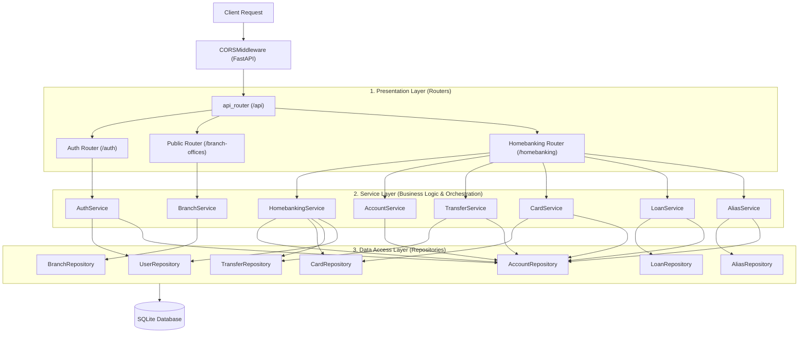
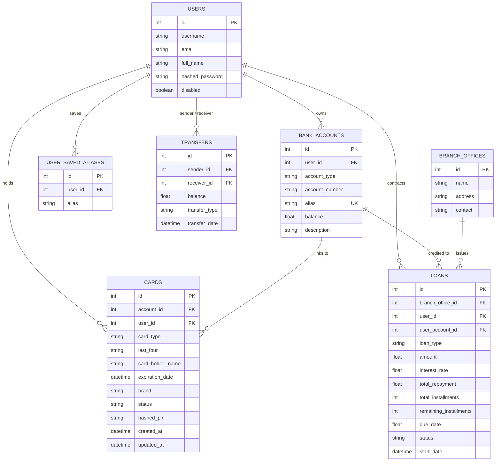

# AGENTS.md — AI Developer & Agent Guide

> **Project:** ITBANK Backend (Fictitious Homebanking API)  
> **Repository Context:** ITBA Full-Stack Course Backend Application  
> **Primary Framework:** FastAPI (Python 3.13+) with SQLModel / SQLite  
> **Current Working Branch:** `refactor`  
> **Architecture Pattern:** 3-Tier Layered Architecture (Routers → Services → Repositories)  
> **Target Audience:** Autonomous coding agents (Antigravity, Cursor, Claude Code, Copilot) and human developers.

---

## 1. Project Overview & Business Domain

This repository implements the backend REST API for **ITBANK**, a fictitious homebanking and financial services application. The backend serves personal banking operations for authenticated users, including:

- **Authentication & Registration:** User registration, password hashing (Argon2), and OAuth2 Password Bearer flow with JWT issuance.
- **Account Management:** Primary ITBANK checking accounts created on signup, secondary account creation, balance checks, alias generation, and updates.
- **Transfers & Deposits:** Funds transfer between accounts via aliases, transaction history, and balance deposits.
- **Card Management:** Issuing, viewing, partial/full updating, and deleting credit/debit cards linked to bank accounts.
- **Loans / Credit Lines:** Applying for loans with installment schedules, interest calculations, disbursement into user accounts, and status tracking.
- **Public Services:** Public directory of ITBANK physical branch offices and a server-alive health check.

---

## 2. Technology Stack & Specifications

| Category | Technology / Library | Version / Spec | Purpose |
| :--- | :--- | :--- | :--- |
| **Runtime** | Python | `>=3.13` | Core execution environment |
| **Web Framework** | FastAPI (standard) | `^0.116.1` | Async REST API routing, OpenAPI docs, and DI |
| **Server Engine** | Uvicorn | Integrated | ASGI server |
| **ORM / Data Layer** | SQLModel | `^0.0.24` | Hybrid Pydantic v2 + SQLAlchemy 2.0 ORM |
| **Database** | SQLite | File (`src/database.db`) / In-Memory (`sqlite://`) for tests | Persistence layer |
| **Authentication** | PyJWT | `^2.10.1` | JSON Web Token encoding, decoding, and validation |
| **Password Security** | pwdlib[argon2] | `^0.3.0` | Password and PIN hashing via Argon2id |
| **Configuration** | python-dotenv / pytest-dotenv | `^1.2.1` / `^0.5.2` | `.env` variable loading for dev and tests |
| **Testing** | Pytest + Pytest-cov | `^9.0.2` / `^7.0.0` | Unit & integration testing with coverage metrics |
| **HTTP Testing** | Starlette TestClient / HTTPX | Built-in | Endpoint test client |
| **Mocking / Utilities**| Faker + Coolname | `^40.44.0` / `^4.0.0` | Dynamic test fixture data and bank alias generation |
| **Dependency Manager**| Poetry (poetry-core) | `^2.0.0` | Packaging and environment resolution |

---

## 3. Architecture & Routing Hierarchy

### 3.1 3-Tier Layered Architecture

The application adopts a **3-Tier Layered Architecture** separating presentation, business logic, and persistence:



### 3.2 Layer Rules & Responsibilities

1. **Routers (`src/routers/api/...`):**
   - Thin controllers declaring routes, path parameters, query parameters, and Pydantic bodies.
   - Inject service dependencies (e.g. `AccountServiceDep`, `TransferServiceDep`, `CurrentUserDep`).
   - Call service methods and return response models or status codes.
   - **No SQL queries or raw session mutations allowed in routers.**

2. **Services (`src/services/...`):**
   - Encapsulate business rules, validation, mathematical calculations, and coordination across repositories.
   - Orchestrate atomic operations and database commits.
   - Raise domain exceptions from `src.exceptions` (e.g., `EntityNotFoundError`, `InsufficientFundsError`, `InvalidOperationError`).
   - Free from HTTP knowledge (no `HTTPException`, no status codes).

3. **Repositories (`src/repositories/...`):**
   - Inherit from `BaseRepository[T]` for standard CRUD operations (`get_by_id`, `list_all`, `add`, `delete`, `commit`, `refresh`, `flush`).
   - Implement optimized, explicit queries preventing Cartesian joins.
   - Pure data access without business validation logic.

4. **Exception Handlers (`src/handlers/...`):**
   - Global exception handler maps `BankingException` subclasses into standard JSON responses (`{"detail": ...}`) with appropriate HTTP status codes (400, 403, 404).

---

## 4. Directory Structure & File Map

```text
itba_full_stack_back_fastapi/
├── pyproject.toml              # Dependencies (including pytest-dotenv) and pytest config
├── poetry.lock                 # Locked dependency graph
├── .env                        # Local development environment configuration
├── .env.test                   # Test environment variables
├── TODO.md                     # Immediate developer roadmap items
├── AGENTS.md                   # AI Developer and Agent Operational Manual (this file)
├── src/
│   ├── main.py                 # FastAPI app, lifespan, CORS, exception handlers registration
│   ├── constants/
│   │   └── constants.py        # Route prefixes, table names, JWT parameters, error messages
│   ├── db/                     # DB engine & session
│   │   ├── connection.py       # Engine creation, SessionDep, create_db_and_tables
│   │   └── user.py             # User lookup query helper
│   ├── exceptions/             # Pure domain exception definitions
│   │   ├── __init__.py
│   │   └── banking_exceptions.py # BankingException, EntityNotFoundError, InsufficientFundsError, etc.
│   ├── handlers/               # Global FastAPI exception handlers
│   │   ├── __init__.py
│   │   └── exception_handlers.py # Maps domain exceptions to HTTP JSON responses
│   ├── models/                 # SQLModel tables and Pydantic schemas
│   │   ├── accounts.py         # BankAccount table & request/update models
│   │   ├── auth.py             # Token & RegisterResponse models
│   │   ├── branch_offices.py   # BranchOffice table & create models
│   │   ├── cards.py            # Card table & response/create/update models
│   │   ├── deposit.py          # DepositCreate request model
│   │   ├── homebanking.py      # Homebanking response models
│   │   ├── loans.py            # Loan table & request/update models
│   │   ├── transfers.py        # Transfer table & response/create models
│   │   ├── user_saved_aliases.py # UserSavedAlias table & response models
│   │   └── users.py            # User table & registration/profile models
│   ├── repositories/           # Data access layer (SQLModel queries)
│   │   ├── __init__.py
│   │   ├── base.py             # Generic BaseRepository[T]
│   │   ├── account_repository.py # BankAccount queries
│   │   ├── alias_repository.py   # UserSavedAlias queries
│   │   ├── branch_repository.py  # BranchOffice queries
│   │   ├── card_repository.py    # Card queries (clean joins, no Cartesian products)
│   │   ├── loan_repository.py    # Loan queries
│   │   ├── transfer_repository.py # Transfer queries with aliased user joins
│   │   └── user_repository.py    # User queries
│   ├── services/               # Business logic & domain orchestration
│   │   ├── __init__.py
│   │   ├── account_service.py    # AccountService & AccountServiceDep
│   │   ├── alias_service.py      # AliasService & AliasServiceDep
│   │   ├── auth_service.py       # AuthService & AuthServiceDep
│   │   ├── branch_service.py     # BranchService & BranchServiceDep
│   │   ├── card_service.py       # CardService & CardServiceDep
│   │   ├── homebanking_service.py# HomebankingService & HomebankingServiceDep
│   │   ├── loan_service.py       # LoanService & LoanServiceDep
│   │   └── transfer_service.py   # TransferService & TransferServiceDep
│   ├── routers/                # Presentation layer (thin controllers)
│   │   ├── routers.py          # Merges itbank and auth routers under /api
│   │   └── api/
│   │       ├── auth/
│   │       │   └── auth.py     # Injects AuthServiceDep
│   │       └── itbank/
│   │           ├── itbank.py   # Merges public and homebanking routers
│   │           ├── public/
│   │           │   └── public.py # Injects BranchServiceDep
│   │           └── homebanking/
│   │               ├── homebanking.py # Injects HomebankingServiceDep
│   │               ├── accounts/accounts.py # Injects AccountServiceDep
│   │               ├── alias/alias.py       # Injects AliasServiceDep
│   │               ├── cards/cards.py       # Injects CardServiceDep
│   │               ├── deposit/deposit.py   # Injects TransferServiceDep
│   │               ├── loans/loans.py       # Injects LoanServiceDep
│   │               └── transfers/transfers.py # Injects TransferServiceDep
│   └── utils/                  # Domain utilities, security, and dependency providers
│       ├── auth_user.py        # Token issuance, get_current_user, CurrentUserDep
│       ├── password.py         # Argon2 password hashing and verification
│       └── text_generation.py  # Alias generator, account number generator, FakerDep
└── tests/                      # Automated test suite (Pytest + Starlette TestClient)
    ├── conftest.py             # Test fixtures: in-memory DB, client, client_auth, faker
    ├── utils.py                # Test helper functions (user factory)
    ├── homebanking_test.py     # Integration tests for dashboard
    ├── accounts/               # Account endpoints test suite
    ├── alias/                  # Alias endpoints test suite
    ├── auth/                   # Authentication & registration tests
    ├── branch-offices/         # Branch office tests
    ├── cards/                  # Card issuing and management tests
    ├── deposit/                # Deposit tests
    ├── loans/                  # Loan lifecycle tests
    └── transfers/              # Transfer transaction tests
```

---

## 5. Data Models & Entity Relationships



---

## 6. Developer & Agent Workflow

### 6.1 Environment Setup

1. **Install Poetry:** Ensure Poetry `>= 2.0.0` is available.
2. **Install Dependencies:**
   ```bash
   poetry install
   ```
3. **Configure Environment Variables:**
   Create `.env` based on the following keys:
   ```env
   AUTH_SECRET_KEY="your-jwt-secret-key-32-chars-minimum"
   ALGORITHM="HS256"
   ITBANK_HOMEBANKING_FRONTEND_URL="http://localhost:3000"
   ```

### 6.2 Running the Application

- **Via Python module:**
  ```bash
  poetry run python -m src.main
  ```
- **Via Uvicorn directly with hot reload:**
  ```bash
  poetry run uvicorn src.main:app --host 0.0.0.0 --port 8000 --reload
  ```
- **Interactive Documentation:**
  - Swagger UI: `http://localhost:8000/docs`
  - ReDoc: `http://localhost:8000/redoc`

### 6.3 Executing Tests

With `pytest-dotenv` installed, `.env.test` is loaded automatically during test execution:

```bash
# Run all tests
poetry run pytest

# Run tests with verbose output
poetry run pytest -vv

# Run tests with coverage metrics
poetry run pytest --cov=src -vv
```

---

## 7. Resolved Items & Remaining Technical Debt

### 7.1 Resolved Issues
- [x] **Layered Architecture Implemented:** Separated presentation (`routers`), business logic (`services`), and data persistence (`repositories`).
- [x] **Cartesian Product Queries Eliminated:** `CardRepository` and `AccountRepository` perform direct, indexed lookups avoiding cross joins. 0 `SAWarning` occurrences in the entire test suite.
- [x] **Test Configuration (`pytest-dotenv`):** Added `pytest-dotenv = "^0.5.2"` to `pyproject.toml`. Pytest now passes completely without manual env variable exports.
- [x] **Dependency Injection Standardized:** Consolidated session, current user, and mock fixtures into `SessionDep`, `CurrentUserDep`, and `FakerDep`.

### 7.2 Remaining Technical Debt & Domain Opportunities
- **Loan Account Reference (`loans.py`):**  
  `user_account_id: int = Field(foreign_key="bank_accounts.user_id")`  
  This references `bank_accounts.user_id` instead of `bank_accounts.id` (the primary key).
- **Concurrency & Missing Row Locks:**  
  Transfer and balance modifications should incorporate row locks (`select(...).with_for_update()`) to safeguard high-concurrency environments.
- **Floating-Point Currency:**  
  All monetary balances (`balance`, `amount`, `total_repayment`) currently use `float`. In financial software, this should ideally be refactored to `Decimal` (SQLAlchemy `Numeric`).
- **Audit Trails vs Raw Deletions:**  
  `delete_transfer` deletes transactions from the database without balance reversal or audit history. Transactions in financial domains should be immutable (soft delete or reversal records).

---

## 8. Prioritized Improvement Roadmap

### Phase 1: High Priority / Stability Fixes
- [x] Complete dependency injection refactor (`SessionDep`, `CurrentUserDep`, `FakerDep`).
- [x] Add `pytest-dotenv = "^0.5.2"` to `pyproject.toml`.
- [x] Fix Cartesian product queries across all repositories.
- [x] Introduce Service and Repository layers to decouple business logic from FastAPI routers.
- [ ] Correct foreign key on `Loan.user_account_id` to point to `bank_accounts.id`.

### Phase 2: Domain Integrity & Financial Correctness
- [ ] Wrap balance adjustments and transfers inside row-level locks (`with_for_update()`).
- [ ] Refactor monetary balances from `float` to `Decimal` (SQLAlchemy `Numeric` / Pydantic `Decimal`).
- [ ] Prohibit raw deletion of financial transaction logs (`Transfer`); replace with status / reversal records.
- [ ] Implement checks for overdraft limits and account freezes.

### Phase 3: Architecture & Security Hardening
- [ ] Implement database migrations using Alembic rather than relying on `SQLModel.metadata.create_all()` at startup.
- [ ] Restrict `GET /homebanking/users` (currently leaks all user emails and names to any authenticated client).
- [ ] Add refresh tokens and revocation / blacklist mechanisms for JWTs.
- [ ] Implement unique constraints and email format validation on `User.email`.

---

## 9. Rules of Engagement for AI Agents

When implementing features, refactoring, or fixing bugs in this repository, follow these rules:

1. **Adhere to the 3-Tier Layered Architecture:**
   - **Routers** handle HTTP routing, validate request schemas, and delegate directly to services. Never query or commit to the database directly in a router.
   - **Services** orchestrate business workflows, handle transaction commits, and raise typed exceptions from `src.exceptions`.
   - **Repositories** extend `BaseRepository` and encapsulate all SQLModel queries.
2. **Prevent Cartesian Queries:** Never reference unjoined tables in a `.where()` clause. Always use direct foreign key filters or explicit `.join()` methods.
3. **Use Established Dependency Injection:**
   - Services must be injected into routers using their typed dependency (e.g., `AccountServiceDep`, `TransferServiceDep`).
   - Authenticated user context must use `CurrentUserDep` from `src.utils.auth_user`.
   - Sessions must use `SessionDep` from `src.db.connection`.
4. **Preserve Router Contract & Prefix Structure:** Route paths must respect `API_PREFIX` (`/api`), `ITBANK_PREFIX` (`/itbank`), and `HOME_BANKING_PREFIX` (`/homebanking`).
5. **Always Verify Tests First:** Execute `poetry run pytest` before and after modifications. Ensure no warnings or failures are introduced.
