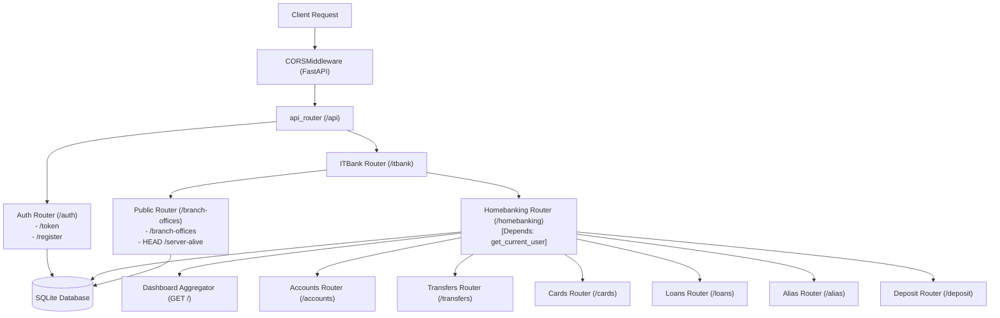
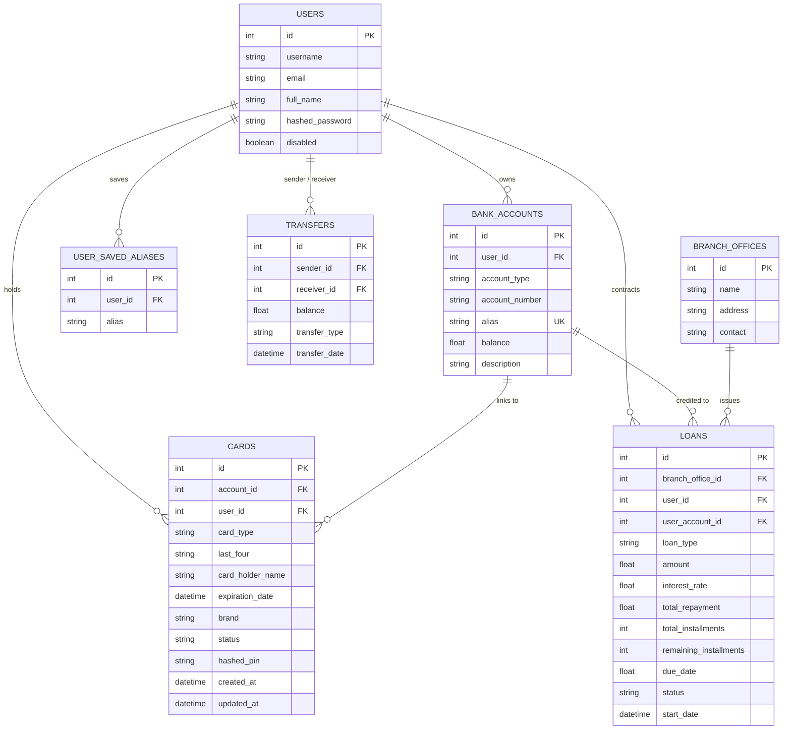

# AGENTS.md — AI Developer & Agent Guide

> **Project:** ITBANK Backend (Fictitious Homebanking API)  
> **Repository Context:** ITBA Full-Stack Course Backend Application  
> **Primary Framework:** FastAPI (Python 3.13+) with SQLModel / SQLite  
> **Current Working Branch:** `refactor`  
> **Target Audience:** Autonomous coding agents (Antigravity, Cursor, Claude Code, Copilot) and human developers.

---

## 1. Project Overview & Business Domain

This repository implements the backend REST API for **ITBANK**, a fictitious homebanking and financial services application. The backend serves personal banking operations for authenticated users, including:

- **Authentication & Registration:** User registration, password hashing (Argon2), and OAuth2 Password Bearer flow with JWT issuance.
- **Account Management:** Primary ITBANK checking accounts created on signup, secondary account creation, balance checks, alias generation, and updates.
- **Transfers & Deposits:** Funds transfer between accounts via aliases, transaction history, and balance deposits.
- **Card Management:** Issuing, viewing, partial/full updating, and deleting credit/debit cards linked to bank accounts.
- **Loans / Credit Lines:** Applying for loans with installment schedules, interest calculations, disbursement into user accounts, and status tracking.
- **Public Services:** Public directory of ITBANK physical branch offices and a server-alive health check.

---

## 2. Technology Stack & Specifications

| Category | Technology / Library | Version / Spec | Purpose |
| :--- | :--- | :--- | :--- |
| **Runtime** | Python | `>=3.13` | Core execution environment |
| **Web Framework** | FastAPI (standard) | `^0.116.1` | Async REST API routing, OpenAPI docs, and DI |
| **Server Engine** | Uvicorn | Integrated | ASGI server |
| **ORM / Data Layer** | SQLModel | `^0.0.24` | Hybrid Pydantic v2 + SQLAlchemy 2.0 ORM |
| **Database** | SQLite | File (`src/database.db`) / In-Memory (`sqlite://`) for tests | Persistence layer |
| **Authentication** | PyJWT | `^2.10.1` | JSON Web Token encoding, decoding, and validation |
| **Password Security** | pwdlib[argon2] | `^0.3.0` | Password and PIN hashing via Argon2id |
| **Configuration** | python-dotenv | `^1.2.1` | `.env` variable loading |
| **Testing** | Pytest + Pytest-cov | `^9.0.2` / `^7.0.0` | Unit & integration testing with coverage metrics |
| **HTTP Testing** | Starlette TestClient / HTTPX | Built-in | Endpoint test client |
| **Mocking / Utilities**| Faker + Coolname | `^40.44.0` / `^4.0.0` | Dynamic test fixture data and bank alias generation |
| **Dependency Manager**| Poetry (poetry-core) | `^2.0.0` | Packaging and environment resolution |

---

## 3. Architecture & Routing Hierarchy

### 3.1 Architecture Overview

The system follows a modular FastAPI architecture utilizing Dependency Injection (`fastapi.Depends`) for database sessions (`SessionDep` from `src.db.connection`), current authenticated user resolution (`CurrentUserDep` from `src.utils.auth_user`), and test fixtures / mock data providers (`FakerDep` from `src.utils.text_generation`).



### 3.2 Endpoint Tree

- **`/api/auth`** (`tags=["auth"]`)
  - `POST /register`: Register user and automatically provision an ITBANK checking account with generated account number and alias.
  - `POST /token`: Authenticate with form credentials (`username`, `password`) and receive a Bearer JWT.
- **`/api/itbank`** (`tags=["branch-offices"]`)
  - `HEAD /server-alive`: Lightweight server healthcheck returning `{"response": "ok"}`.
  - `GET /branch-offices`: List all physical branch offices.
  - `POST /branch-offices`: Create a branch office (uses `FakerDep` generator).
  - `DELETE /branch-offices/{branch_office_id}`: Delete a branch office.
- **`/api/itbank/homebanking`** (`tags=["homebanking"]`, protected by `get_current_user`)
  - `GET /`: Aggregate dashboard data (current user, ITBANK account, cards, transfers).
  - `GET /me`: Authenticated user profile.
  - `GET /users`: List all registered users (IDs, emails, usernames, names).
- **`/api/itbank/homebanking/accounts`** (`tags=["accounts"]`)
  - `GET /`: List all accounts owned by current user.
  - `GET /by/`: Query single account by `acc_number`, `acc_id`, or `acc_alias`.
  - `POST /`: Create additional account for user.
  - `PATCH /`: Partial update of account attributes.
  - `PUT /`: Full update of account attributes.
  - `DELETE /`: Delete account by ID, number, or alias.
- **`/api/itbank/homebanking/transfers`** (`tags=["transfers"]`)
  - `GET /`: Transfer history where user is sender or receiver.
  - `POST /`: Execute funds transfer between accounts by alias.
  - `DELETE /{transfer_id}`: Delete a transfer record.
- **`/api/itbank/homebanking/cards`** (`tags=["cards"]`)
  - `GET /`: List all cards owned by current user.
  - `GET /{card_id}`: Get card details.
  - `POST /`: Issue card linked to an account with hashed PIN.
  - `PATCH /{card_id}` / `PUT /{card_id}`: Partial/full update.
  - `DELETE /{card_id}`: Remove card.
- **`/api/itbank/homebanking/loans`** (`tags=["loans"]`)
  - `GET /`: List user loans.
  - `GET /{loan_id}`: Get loan detail.
  - `POST /`: Request loan, calculate repayment, and credit funds to account.
  - `PATCH /{loan_id}` / `PUT /{loan_id}`: Update loan status/installments.
  - `DELETE /{loan_id}`: Delete loan and deduct balance.
- **`/api/itbank/homebanking/alias`** (`tags=["alias"]`)
  - `GET /all`: User account aliases.
  - `GET /itbank`: Default ITBANK account alias.
  - `GET /save`: User saved beneficiary aliases.
  - `POST /save/{alias}`: Save alias to address book.
- **`/api/itbank/homebanking/deposit`** (`tags=["deposit"]`)
  - `POST /`: Deposit money into account by alias.

---

## 4. Directory Structure & File Map

```text
itba_full_stack_back_fastapi/
├── pyproject.toml              # Project metadata, dependencies, and pytest configuration
├── poetry.lock                 # Locked dependency graph
├── .env                        # Local development environment configuration
├── .env.test                   # Test environment variables
├── TODO.md                     # Roadmap and immediate developer TODO items
├── AGENTS.md                   # AI Developer and Agent Operational Manual (this file)
├── src/
│   ├── main.py                 # FastAPI application instantiation, lifespan, CORS, dotenv loader
│   ├── constants/
│   │   └── constants.py        # Route prefixes, table names, JWT parameters, error messages
│   ├── db/                     # Persistence & DB query helpers
│   │   ├── connection.py       # Engine creation, SessionDep, create_db_and_tables
│   │   └── user.py             # User queries (get_user helper)
│   ├── models/                 # SQLModel tables and Pydantic schemas
│   │   ├── accounts.py         # BankAccount table & request/update models
│   │   ├── auth.py             # Token & RegisterResponse models
│   │   ├── branch_offices.py   # BranchOffice table & create models
│   │   ├── cards.py            # Card table & response/create/update models
│   │   ├── deposit.py          # DepositCreate request model
│   │   ├── homebanking.py      # Homebanking response models
│   │   ├── loans.py            # Loan table & request/update models
│   │   ├── transfers.py        # Transfer table & response/create models
│   │   ├── user_saved_aliases.py # UserSavedAlias table & response models
│   │   └── users.py            # User table & registration/profile models
│   ├── routers/                # Modular router definitions
│   │   ├── routers.py          # Merges itbank and auth routers under /api
│   │   └── api/
│   │       ├── auth/
│   │       │   └── auth.py     # Auth login and register routes
│   │       └── itbank/
│   │           ├── itbank.py   # Merges public and homebanking routers
│   │           ├── public/
│   │           │   └── public.py # Branch offices endpoints & /server-alive health check
│   │           └── homebanking/
│   │               ├── homebanking.py # Main homebanking dashboard & sub-routers
│   │               ├── accounts/accounts.py
│   │               ├── alias/alias.py
│   │               ├── cards/cards.py
│   │               ├── deposit/deposit.py
│   │               ├── loans/loans.py
│   │               └── transfers/transfers.py
│   └── utils/                  # Domain utilities, security, and dependency providers
│       ├── auth_user.py        # Token issuance, get_current_user, CurrentUserDep
│       ├── password.py         # Argon2 password hashing and verification
│       └── text_generation.py  # Alias generator, account number generator, FakerDep
└── tests/                      # Automated test suite (Pytest + Starlette TestClient)
    ├── conftest.py             # Test fixtures: in-memory DB, client, client_auth, faker
    ├── utils.py                # Test helper functions (user factory)
    ├── homebanking_test.py     # Integration tests for dashboard
    ├── accounts/               # Account endpoints test suite
    ├── alias/                  # Alias endpoints test suite
    ├── auth/                   # Authentication & registration tests
    ├── branch-offices/         # Branch office tests
    ├── cards/                  # Card issuing and management tests
    ├── deposit/                # Deposit tests
    ├── loans/                  # Loan lifecycle tests
    └── transfers/              # Transfer transaction tests
```

---

## 5. Data Models & Entity Relationships



---

## 6. Developer & Agent Workflow

### 6.1 Environment Setup

1. **Install Poetry:** Ensure Poetry `>= 2.0.0` is available.
2. **Install Dependencies:**
   ```bash
   poetry install
   ```
3. **Configure Environment Variables:**
   Create `.env` based on the following keys:
   ```env
   AUTH_SECRET_KEY="your-jwt-secret-key-32-chars-minimum"
   ALGORITHM="HS256"
   ITBANK_HOMEBANKING_FRONTEND_URL="http://localhost:3000"
   ```

### 6.2 Running the Application

- **Via Python module:**
  ```bash
  poetry run python -m src.main
  ```
- **Via Uvicorn directly with hot reload:**
  ```bash
  poetry run uvicorn src.main:app --host 0.0.0.0 --port 8000 --reload
  ```
- **Interactive Documentation:**
  - Swagger UI: `http://localhost:8000/docs`
  - ReDoc: `http://localhost:8000/redoc`

### 6.3 Executing Tests

Because `pytest-dotenv` is currently missing from `pyproject.toml`, test runs require either setting environment variables explicitly or loading `.env.test`:

```bash
# Recommended command to run all tests
AUTH_SECRET_KEY="test_secret_key" ALGORITHM="HS256" poetry run pytest

# Run tests with coverage
AUTH_SECRET_KEY="test_secret_key" ALGORITHM="HS256" poetry run pytest --cov=src -vv
```

---

## 7. Critical Bugs, Technical Debt & Anti-Patterns

When modifying or refactoring this codebase, agents **must** be aware of the following known issues:

### 7.1 SQLAlchemy Cartesian Product Queries (Severe Warning)
In `cards/cards.py` and `deposit/deposit.py`, queries reference unjoined tables in `.where()` clauses:
- **`cards.py`:**
  ```python
  # BAD: Introduces Cartesian product between `users` and `bank_accounts`
  card = session.exec(
      select(Card).where(
          Card.id == card_id,
          Card.account_id == BankAccount.id,
          User.id == current_user.id,
      )
  ).first()
  ```
  **Fix:** Since `Card` already has `user_id`, use:
  ```python
  card = session.exec(
      select(Card).where(Card.id == card_id, Card.user_id == current_user.id)
  ).first()
  ```
- **`deposit.py`:**
  ```python
  # BAD: References User.id without join
  account = session.exec(
      select(BankAccount).where(
          User.id == current_user.id, BankAccount.alias == deposit.alias
      )
  ).first()
  ```
  **Fix:**
  ```python
  account = session.exec(
      select(BankAccount).where(
          BankAccount.user_id == current_user.id, BankAccount.alias == deposit.alias
      )
  ).first()
  ```

### 7.2 Inconsistent Foreign Key Relations
- **Loan Account Reference (`loans.py`):**  
  `user_account_id: int = Field(foreign_key="bank_accounts.user_id")`  
  This references `bank_accounts.user_id` instead of `bank_accounts.id` (the primary key).
- **Transfer Sender/Receiver vs Deposit (`transfers.py` vs `deposit.py`):**  
  In `transfers.py`, `sender_id` and `receiver_id` store `User.id`.  
  In `deposit.py`, `sender_id` and `receiver_id` are set to `account.id`. This breaks relational consistency and joins in transfer history queries.

### 7.3 Concurrency & Missing Transaction Isolation
- Transfer operations (`make_transfer`), deposits, and loan balance disbursements perform multiple read-modify-write steps without row locks (`with_for_update()`) or atomic database transactions. Under concurrent requests, race conditions will result in lost updates or double-spending.

### 7.4 Floating-Point Currency
- All monetary balances (`balance`, `amount`, `total_repayment`) use `float`. In financial software, this leads to floating-point rounding errors. They should be refactored to `Decimal` or integer cents.

### 7.5 Unsafe Deletions (Financial Audit Trails)
- `delete_transfer` deletes transactions from the database without balance reversal or audit history. In banking domains, financial transactions must be immutable.
- `delete_loan` decrements the principal amount from the user account balance without taking accrued interest, installments paid, or minimum balances into account.

### 7.6 Alias Collision Logic in `save_alias`
- In `src/routers/api/itbank/homebanking/alias/alias.py`:
  ```python
  alias = session.exec(
      select(UserSavedAlias).where(UserSavedAlias.alias == alias)
  ).first()
  if alias:
      raise HTTPException(status_code=400, detail="Alias already saved")
  ```
  This checks whether **any user in the entire database** has saved the alias. User B cannot save an alias if User A has already saved it. The query must filter by `UserSavedAlias.user_id == current_user.id`.

### 7.7 Completed Dependency Injection Refactor
- The legacy `src/dependencies.py`, `src/lib/`, and intermediate `src/core/` folders have been successfully superseded:
  - Database sessions are consolidated into `SessionDep` (`src.db.connection`).
  - Current user authentication is consolidated into `CurrentUserDep` (`src.utils.auth_user`).
  - Mock providers are consolidated into `FakerDep` (`src.utils.text_generation`).
  - All router handlers consistently utilize these typed annotations.

### 7.8 Configuration & Testing Gotchas
- `src/constants/constants.py` reads `os.getenv("AUTH_SECRET_KEY")` at import time. If imported before `load_dotenv()` runs (or in tests without `pytest-dotenv`), `SECRET_KEY` evaluates to `None`, causing JWT encoding to throw `TypeError: Expected a string value`.
- Add `pytest-dotenv` to dependencies so `[tool.pytest.ini_options] env_files = [".env.test"]` takes effect automatically.

---

## 8. Prioritized Improvement Roadmap

### Phase 1: High Priority / Stability Fixes
- [x] Complete dependency injection refactor and align imports across all routers (`SessionDep`, `CurrentUserDep`, `FakerDep`).
- [ ] Add `pytest-dotenv = "^0.5.2"` to `pyproject.toml` to fix standalone `poetry run pytest` executions.
- [ ] Fix Cartesian product queries in `cards.py` and `deposit.py`.
- [ ] Fix `UserSavedAlias` lookup query in `alias.py` to filter by `current_user.id`.
- [ ] Correct foreign key on `Loan.user_account_id` to point to `bank_accounts.id`.
- [ ] Align `deposit.py` transfer record to use `user_id` instead of `account_id` (or standardize `Transfer` on `account_id`).

### Phase 2: Domain Integrity & Financial Correctness
- [ ] Wrap balance adjustments and transfers inside atomic transactions (`with session.begin():`).
- [ ] Refactor monetary balances from `float` to `Decimal` (SQLAlchemy `Numeric` / Pydantic `Decimal`).
- [ ] Prohibit raw deletion of financial transaction logs (`Transfer`); replace with status / reversal records.
- [ ] Implement checks for negative transfer amounts and overdraft limits.

### Phase 3: Architecture & Security Hardening
- [ ] Introduce a Service / Repository layer to decouple business logic from FastAPI routers.
- [ ] Implement database migrations using Alembic rather than relying on `SQLModel.metadata.create_all()` at startup.
- [ ] Restrict `GET /homebanking/users` (currently leaks all user emails and names to any authenticated client).
- [ ] Add refresh tokens and revocation / blacklist mechanisms for JWTs.
- [ ] Implement unique constraints and email format validation on `User.email`.

---

## 9. Rules of Engagement for AI Agents

When implementing features, refactoring, or fixing bugs in this repository, follow these rules:

1. **Always Verify Tests First:** Run the test suite before and after making changes. If tests fail with `TypeError: Expected a string value`, verify `AUTH_SECRET_KEY` and `ALGORITHM` are loaded into the environment.
2. **Prevent Cartesian Queries:** Never include multiple models in a `.where()` clause without explicitly joining them using `.join()`. Prefer querying by direct foreign keys on the model being selected.
3. **Preserve Router Contract & Prefix Structure:** Route paths must respect `API_PREFIX` (`/api`), `ITBANK_PREFIX` (`/itbank`), and `HOME_BANKING_PREFIX` (`/homebanking`). Do not duplicate prefixes in sub-routers.
4. **Use Established Dependency Injection:**
   - Database sessions must use `SessionDep` from `src.db.connection`.
   - Current authenticated user must use `CurrentUserDep` from `src.utils.auth_user`.
   - Mock data in routers/tests must use `FakerDep` from `src.utils.text_generation` or `fake` fixture.
5. **Maintain Documentation Integrity:** If you modify endpoint contracts, update OpenAPI docstrings, models, and this `AGENTS.md` file accordingly.
