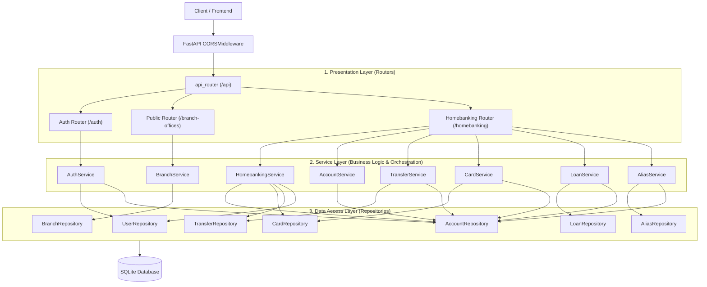

# ITBANK — Backend REST API

[](https://www.python.org/)
[](https://fastapi.tiangolo.com)
[](https://sqlmodel.tiangolo.com/)
[](https://python-poetry.org/)
[]()

> A fictitious homebanking backend web application built with **Python 3.13+** and **FastAPI**, developed as part of the **ITBA Full-Stack Web Development Course**.

---

## 📖 Table of Contents

- [Project Overview](#-project-overview)
- [Key Features](#-key-features)
- [Architecture & Design](#-architecture--design)
- [Tech Stack](#-tech-stack)
- [Project Structure](#-project-structure)
- [Getting Started](#-getting-started)
  - [Prerequisites](#prerequisites)
  - [Installation](#installation)
  - [Environment Variables](#environment-variables)
  - [Running the Server](#running-the-server)
- [API Documentation](#-api-documentation)
  - [Interactive Docs](#interactive-docs)
  - [Endpoint Overview](#endpoint-overview)
- [Testing & Coverage](#-testing--coverage)
- [Developer Guide for AI Agents](#-developer-guide-for-ai-agents)
- [Author & Acknowledgments](#-author--acknowledgments)

---

## 🏦 Project Overview

**ITBANK** is a full-featured personal homebanking REST API designed to power modern financial frontend applications. It simulates core retail banking functions, including user account provisioning, funds transfers, credit/debit card management, loan underwriting with automatic disbursement, address books, and branch office directories.

The application follows a **3-Tier Layered Architecture** separating presentation (FastAPI routers), domain business rules (services), and data access (repositories), ensuring high testability, clean boundaries, and zero SQL Cartesian product issues.

---

## ✨ Key Features

- **🔐 Authentication & Registration:**
  - Secure user onboarding with password hashing using **Argon2id** (`pwdlib`).
  - Automated provisioning of a primary ITBANK checking account upon registration.
  - OAuth2 Password Bearer flow with JWT access token generation (`PyJWT`).
- **💼 Account Management:**
  - Manage primary and secondary bank accounts.
  - Dynamic banking alias generation using custom slug patterns (`{username}.word.word.word`).
  - Query accounts by ID, account number, or alias.
  - Full and partial account updates.
- **💸 Transfers & Balance Operations:**
  - Peer-to-peer balance transfers between accounts using banking aliases.
  - Direct balance deposits.
  - Complete transaction history with sender and receiver identity resolution.
- **💳 Card Management:**
  - Issue credit and debit cards linked to existing bank accounts.
  - Secure PIN hashing and card status management (active, blocked, expired).
  - Full and partial updates (e.g. cardholder name, status, expiration).
- **📊 Loans & Credit Facilities:**
  - Apply for loans with automatic interest rate calculations and total repayment schedules.
  - Instant principal disbursement directly into the applicant's linked bank account.
  - Track total and remaining installment schedules.
- **🏷️ Address Book (Saved Aliases):**
  - Save frequently used beneficiary aliases for quick access during transfers.
- **🏢 Public Directory & Health Probe:**
  - Public directory of physical branch offices.
  - Lightweight `/server-alive` health check endpoint for monitoring.
- **📈 Dashboard Aggregator:**
  - Composite endpoint (`GET /api/itbank/homebanking/`) aggregating user profile details, primary accounts, active cards, and recent transfer logs in a single request.

---

## 🏛️ Architecture & Design

The backend implements a **3-Tier Layered Architecture** to separate concerns cleanly:



- **Routers (`src/routers/`):** Thin controllers handling HTTP requests, path/query validation, dependency injection, and HTTP responses. No database operations or business calculations are executed here.
- **Services (`src/services/`):** Encapsulate business logic, invariant checks (e.g. overdraft rules, self-transfer prevention), cross-repository coordination, and transaction commits. Raises domain exceptions from `src.exceptions`.
- **Repositories (`src/repositories/`):** Inherit from `BaseRepository[T]` to encapsulate all SQLModel / SQLAlchemy queries, ensuring clean joins and optimized lookups.
- **Exception Handlers (`src/handlers/`):** Global exception middleware converting domain exceptions (`BankingException`, `EntityNotFoundError`, `InsufficientFundsError`) into standard JSON responses (`{"detail": ...}`).

---

## 🛠️ Tech Stack

| Technology | Version / Spec | Purpose |
| :--- | :--- | :--- |
| **Python** | `>=3.13` | Modern Python execution runtime |
| **FastAPI** | `^0.116.1` | High-performance asynchronous web framework |
| **Uvicorn** | Integrated | ASGI web server |
| **SQLModel** | `^0.0.24` | Hybrid SQLAlchemy 2.0 ORM + Pydantic v2 data validation |
| **SQLite** | Standard / In-Memory | Relational database (file for dev, in-memory for tests) |
| **PyJWT** | `^2.10.1` | JSON Web Token encoding, decoding, and validation |
| **pwdlib[argon2]** | `^0.3.0` | State-of-the-art password and PIN hashing |
| **Poetry** | `^2.0.0` | Dependency resolution, packaging, and virtualenv management |
| **Pytest** | `^9.0.2` | Comprehensive unit and integration testing suite |
| **Pytest-Cov** | `^7.0.0` | Test coverage metrics reporting |
| **Pytest-Dotenv**| `^0.5.2` | Automatic `.env.test` loading during test runs |
| **Faker** | `^40.44.0` | Realistic mock data generation for testing and seed data |
| **Coolname** | `^4.0.0` | Bank alias slug generation |

---

## 📁 Project Structure

```text
itba_full_stack_back_fastapi/
├── pyproject.toml              # Dependencies, build metadata, and pytest configuration
├── poetry.lock                 # Locked dependency tree
├── .env                        # Local development environment configuration
├── .env.test                   # Test environment configuration
├── README.md                   # Project documentation (this file)
├── AGENTS.md                   # Operational guide for AI agents and developers
├── src/
│   ├── main.py                 # FastAPI application, lifespan, CORS, and exception handler setup
│   ├── constants/
│   │   └── constants.py        # Route prefixes, table names, JWT constants, and error messages
│   ├── db/                     # DB engine & session
│   │   └── connection.py       # Engine creation, SessionDep, create_db_and_tables
│   ├── exceptions/             # Pure domain exception definitions
│   │   ├── __init__.py
│   │   └── banking_exceptions.py # BankingException, EntityNotFoundError, InsufficientFundsError, etc.
│   ├── handlers/               # Global FastAPI exception handlers
│   │   ├── __init__.py
│   │   └── exception_handlers.py # Maps domain exceptions to HTTP JSON responses
│   ├── models/                 # SQLModel tables and Pydantic schemas
│   │   ├── accounts.py         # BankAccount table & request/update models
│   │   ├── auth.py             # Token & RegisterResponse models
│   │   ├── branch_offices.py   # BranchOffice table & create models
│   │   ├── cards.py            # Card table & response/create/update models
│   │   ├── deposit.py          # DepositCreate request model
│   │   ├── homebanking.py      # Homebanking response models
│   │   ├── loans.py            # Loan table & request/update models
│   │   ├── transfers.py        # Transfer table & response/create models
│   │   ├── user_saved_aliases.py # UserSavedAlias table & response models
│   │   └── users.py            # User table & registration/profile models
│   ├── repositories/           # Data access layer
│   │   ├── __init__.py
│   │   ├── base.py             # Generic BaseRepository[T]
│   │   ├── account_repository.py
│   │   ├── alias_repository.py
│   │   ├── branch_repository.py
│   │   ├── card_repository.py
│   │   ├── loan_repository.py
│   │   ├── transfer_repository.py
│   │   └── user_repository.py
│   ├── services/               # Business logic & orchestration
│   │   ├── __init__.py
│   │   ├── account_service.py  # AccountService & AccountServiceDep
│   │   ├── alias_service.py    # AliasService & AliasServiceDep
│   │   ├── auth_service.py     # AuthService & AuthServiceDep
│   │   ├── branch_service.py   # BranchService & BranchServiceDep
│   │   ├── card_service.py     # CardService & CardServiceDep
│   │   ├── homebanking_service.py # HomebankingService & HomebankingServiceDep
│   │   ├── loan_service.py     # LoanService & LoanServiceDep
│   │   └── transfer_service.py # TransferService & TransferServiceDep
│   ├── routers/                # Presentation layer (thin controllers)
│   │   ├── routers.py          # Merges itbank and auth routers under /api
│   │   └── api/
│   │       ├── auth/           # /api/auth
│   │       └── itbank/         # /api/itbank
│   │           ├── public/     # /api/itbank/branch-offices
│   │           └── homebanking/# /api/itbank/homebanking/*
│   └── utils/                  # Domain utilities and dependency providers
│       ├── auth_user.py        # Token issuance, get_user, get_current_user, CurrentUserDep
│       ├── password.py         # Argon2 password hashing and verification
│       └── text_generation.py  # Alias generator, account number generator, FakerDep
└── tests/                      # Automated test suite (84 tests)
    ├── conftest.py             # Pytest fixtures: in-memory DB, test clients, faker
    ├── utils.py                # Test helper functions (user factory)
    ├── homebanking_test.py     # Dashboard integration tests
    ├── accounts/               # Account endpoint tests
    ├── alias/                  # Alias endpoint tests
    ├── auth/                   # Authentication & registration tests
    ├── branch-offices/         # Branch office endpoint tests
    ├── cards/                  # Card issuance & management tests
    ├── deposit/                # Deposit tests
    ├── loans/                  # Loan lifecycle tests
    └── transfers/              # Transfer transaction tests
```

---

## 🚀 Getting Started

### Prerequisites

- **Python:** `>= 3.13` installed on your system.
- **Poetry:** `>= 2.0.0` installed. (Install via [official installer](https://python-poetry.org/docs/#installation)).

### Installation

1. **Clone the repository:**
   ```bash
   git clone https://github.com/your-username/itba_full_stack_back_fastapi.git
   cd itba_full_stack_back_fastapi
   ```

2. **Install dependencies:**
   ```bash
   poetry install
   ```

### Environment Variables

Create a `.env` file in the root directory based on the following template:

```env
AUTH_SECRET_KEY="your-jwt-secret-key-at-least-32-characters"
ALGORITHM="HS256"
ITBANK_HOMEBANKING_FRONTEND_URL="http://localhost:3000"
```

> **Note:** A `.env.test` file is already included in the repository with test-specific secrets and is loaded automatically by `pytest-dotenv`.

### Running the Server

Start the development server with live reload:

```bash
poetry run uvicorn src.main:app --host 0.0.0.0 --port 8000 --reload
```

Or run via Python module:

```bash
poetry run python -m src.main
```

The server will be available at: `http://localhost:8000`

---

## 📚 API Documentation

### Interactive Docs

FastAPI automatically generates interactive OpenAPI documentation:

- **Swagger UI:** [http://localhost:8000/docs](http://localhost:8000/docs)
- **ReDoc:** [http://localhost:8000/redoc](http://localhost:8000/redoc)

### Endpoint Overview

| Method | Endpoint | Description | Auth Required |
| :--- | :--- | :--- | :---: |
| **POST** | `/api/auth/register` | Register user & provision primary checking account | No |
| **POST** | `/api/auth/token` | Obtain JWT access token via OAuth2 password flow | No |
| **HEAD** | `/api/itbank/server-alive` | Lightweight health check | No |
| **GET** | `/api/itbank/branch-offices` | List all branch offices | No |
| **POST** | `/api/itbank/branch-offices` | Create a new branch office | No |
| **DELETE** | `/api/itbank/branch-offices/{id}` | Delete a branch office | No |
| **GET** | `/api/itbank/homebanking/` | Aggregate dashboard (profile, account, cards, transfers) | **Yes** |
| **GET** | `/api/itbank/homebanking/me` | Current authenticated user profile | **Yes** |
| **GET** | `/api/itbank/homebanking/users` | List all registered users | **Yes** |
| **GET** | `/api/itbank/homebanking/accounts/` | List user bank accounts | **Yes** |
| **GET** | `/api/itbank/homebanking/accounts/by/` | Find account by ID, number, or alias | **Yes** |
| **POST** | `/api/itbank/homebanking/accounts/` | Create secondary account | **Yes** |
| **PATCH** | `/api/itbank/homebanking/accounts/` | Partial update of account attributes | **Yes** |
| **PUT** | `/api/itbank/homebanking/accounts/` | Full update of account attributes | **Yes** |
| **DELETE** | `/api/itbank/homebanking/accounts/` | Delete account | **Yes** |
| **GET** | `/api/itbank/homebanking/transfers/` | Transfer history (sent & received) | **Yes** |
| **POST** | `/api/itbank/homebanking/transfers/` | Execute funds transfer by alias | **Yes** |
| **DELETE** | `/api/itbank/homebanking/transfers/{id}` | Delete a transfer record | **Yes** |
| **POST** | `/api/itbank/homebanking/deposit/` | Deposit funds into an account | **Yes** |
| **GET** | `/api/itbank/homebanking/cards/` | List all user cards | **Yes** |
| **GET** | `/api/itbank/homebanking/cards/{id}` | Get card details | **Yes** |
| **POST** | `/api/itbank/homebanking/cards/` | Issue card linked to bank account | **Yes** |
| **PATCH** | `/api/itbank/homebanking/cards/{id}` | Partial update card | **Yes** |
| **PUT** | `/api/itbank/homebanking/cards/{id}` | Full update card | **Yes** |
| **DELETE** | `/api/itbank/homebanking/cards/{id}` | Delete card | **Yes** |
| **GET** | `/api/itbank/homebanking/loans/` | List user loans | **Yes** |
| **GET** | `/api/itbank/homebanking/loans/{id}` | Get loan details | **Yes** |
| **POST** | `/api/itbank/homebanking/loans/` | Apply for loan & disburse funds | **Yes** |
| **PATCH** | `/api/itbank/homebanking/loans/{id}` | Partial update loan | **Yes** |
| **PUT** | `/api/itbank/homebanking/loans/{id}` | Full update loan | **Yes** |
| **DELETE** | `/api/itbank/homebanking/loans/{id}` | Delete loan & revert balance | **Yes** |
| **GET** | `/api/itbank/homebanking/alias/all` | List all user account aliases | **Yes** |
| **GET** | `/api/itbank/homebanking/alias/itbank` | Get primary ITBANK account alias | **Yes** |
| **GET** | `/api/itbank/homebanking/alias/save` | List saved beneficiary aliases | **Yes** |
| **POST** | `/api/itbank/homebanking/alias/save/{alias}` | Save alias to address book | **Yes** |

---

## 🧪 Testing & Coverage

The test suite consists of **84 automated tests** covering all endpoints, authentication logic, transfer flows, and edge cases using an in-memory SQLite database (`sqlite://` with `StaticPool`).

### Running Tests

```bash
# Run all tests
poetry run pytest

# Run with verbose output
poetry run pytest -vv

# Run with test coverage metrics
poetry run pytest --cov=src -vv
```

---

## 🤖 Developer Guide for AI Agents

For autonomous coding assistants and developers contributing to this codebase, please refer to:

👉 **[AGENTS.md](file:///home/agust613/Desktop/agus/projects/itba-fullstack-course/itba_full_stack_back_fastapi/AGENTS.md)**

It provides comprehensive technical instructions on:
- Layer contracts and dependency injection standards (`SessionDep`, `CurrentUserDep`, `FakerDep`).
- Prevention of SQL Cartesian join anti-patterns.
- Financial integrity considerations (transaction boundaries, row locking, decimal currency).
- Roadmap for upcoming architectural and security hardening phases.

---

## 👤 Author & Acknowledgments

- **Author:** Agus Torres ([@agust613](https://github.com/agust613))
- **Email:** torresagustin613@gmail.com
- **Course Context:** ITBA Full-Stack Course (Instituto Tecnológico de Buenos Aires)
